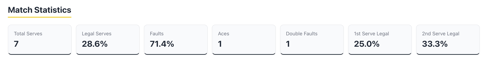
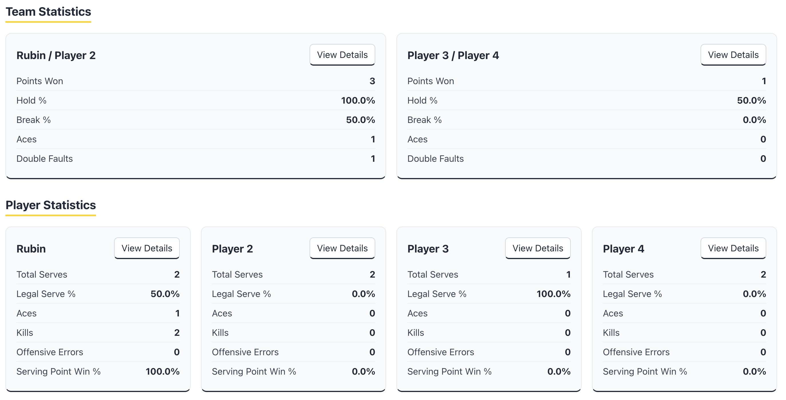

# Roundnet Analyzer

A lightweight, browser-based match analysis tool for reviewing roundnet footage, tagging serve and point outcomes, and generating detailed player, team, and match-level analytics—without specialized video-analysis software.

## Live Demo

[Try Roundnet Analyzer](https://roundnet-analyzer.vercel.app)

## Screenshots

### Match Analysis


### Serve History & Point Tracking


### Match Statistics


---

## Key Features

### Video Analysis & Event Tagging

- **Local Video Analysis:** Upload and review roundnet match footage directly in the browser.
- **Timestamp Tagging:** Tag serves at the video's current playback position.
- **Serve History Jump:** Jump directly to the corresponding video timestamp from Serve History.

### Comprehensive Serve Tracking

- **Serve Parameters:** Track server, receiver, serving hand (left/right), serve type, and attempt number (first/second serve).
- **Outcome Logging:** Record legal serves, faults by type, played-through faults, aces, and returned serves.
- **IRF Fault Types:** Tag every service fault in the IRF rules (July 2026, 4.5), from high, rim and pocket serves to short tosses, same-hand tosses and the 3-second limit. Faults that can never be played through (a miss, double rim, foot fault, dropped toss or late toss) close the attempt straight away.
- **IRF Serving Order:** After the first point of a game, the server and receiver are filled in from the IRF serving order (4.2). Pick a different player to override it.
- **Automatic Double-Fault Detection:** Detect second-serve faults and automatically resolve double-fault points.
- **Replays:** Mark a replay as a serve dispute, a hinder or other (broken equipment, interference). Following IRF 3.2.5, a serve dispute replays only that serve and keeps the fault count; any other replay starts the point again from the first serve. Replayed serves stay in Serve History, marked as replayed, but don't count as attempts or in the serve statistics.
- **Keyboard Shortcuts:** Tag without the mouse: Space, arrows and `,`/`.` control the video; L/R pick the hand; C, V, J, D, T the serve type; G/F legal or fault; A/Enter ace or returned; number keys the fault type or the hitter; K/O kill or offensive error; X not returned; Esc clears; Ctrl+Z undoes. The full list is under Keyboard Shortcuts, below the video.

### Point & Rally Tracking

- **Point Outcomes:** Record point winners, kills, offensive, defensive and receive errors, violations, and other point outcomes.
- **Guided Rallies:** Once a serve is returned, the serve inputs step aside and the app asks for the set (set, far set, or No Set), then who hit the ball, then whether it was a kill, an offensive error, a defensive touch that was kept up (and by whom), or a touch the defender couldn't keep up (still a kill), and repeats until the point ends. A ball that isn't returned is a receive or defensive error. Sets and far sets can be added along the way, and any other ending is one click away.
- **Violations:** Record which point-loss infraction ended the point: under three touches on the serve return, catch, No Hit Zone, hitting your own team, entering the cylinder, or a hinder.
- **Player Attribution:** Attribute kills, errors and violations to individual players.
- **Automatic Resolution:** Automatically resolve point state for aces and double faults.
- **Rally Touches:** Record hits, defensive touches, sets, and far sets during a rally, attributed to individual players, with hitting efficiency per player.
- **Match & Game Info:** Record the date played and the game number; each point is stamped with its game so one export can hold a full match.
- **Live Score:** Show the current game's score, set the target score (11, 15 or 21) and an optional hard cap, and start the next game when one ends.

### Match Analytics

- **Match Statistics:** Track total serves, serve legality, fault rate, aces, double faults, and first- and second-serve legality.
- **Team Statistics:** Calculate points won, hold percentage, break percentage, aces, and double faults.
- **Player Statistics:** Track serving-point win percentage, serve legality, aces, kills, offensive errors, defensive touches, sets, far sets, times aced, and who aced whom.
- **Expandable Statistics:** View additional player- and team-level breakdowns.
- **Per-Game Filter:** Once a match has more than one game, switch the statistics between all games and any single game.

### Editing & Match Management

- **Serve Editing:** Correct serve classifications, outcomes, fault information, serve type, and serving hand.
- **Point Editing:** Correct point winners, outcomes, and responsible players.
- **Deleting:** Delete a stored point (with its serves) or a serve. Deleting a serve from a finished point deletes that point; Undo brings either back.
- **Structural Corrections:** Reopen the most recently completed point when an edit changes the underlying point structure, such as changing an ace or double fault.
- **Undo:** Revert match actions using snapshot-based state restoration.
- **Persistent Match State:** Save match analysis data in browser `localStorage` between refreshes.
- **New Match Reset:** Clear the current match and begin a new analysis.
- **Data Export:** Export complete match data as JSON and serve- or point-level datasets as CSV.
- **Data Import:** Open a JSON export (v1 to v3) to keep tagging or review a match later. The serves of an unfinished point come back too; its rally touches don't, since exports don't carry them.

### JSON Export Format (v3)

The JSON export only adds fields to the original layout, so older readers keep working. Readers that check `formatVersion` need updating for the new values.

- `formatVersion`: `3`.
- `match`: `{ "id": "<uuid>", "playedOn": "YYYY-MM-DD" | null, "pointsTo": 21, "hardCap": null }`. The id is generated per match and changes on Start New Match. `pointsTo` and `hardCap` are new in v3.
- `serves[].faultType` (v3 values): `"High"`, `"Rim"`, `"Pocket"`, `"Missed Net"`, `"Double Rim"`, `"Short Toss"`, `"Same Hand"`, `"Foot on Line"`, `"Dropped Toss"`, `"Three Seconds"`.
- `points[].outcome` (v3 values): adds `"Defensive Error"`, `"Receive Error"` and `"Violation"` to `"Ace"`, `"Double Fault"`, `"Kill"`, `"Offensive Error"` and `"Other"`.
- `points[].violationType` (v3): which infraction, for `"Violation"` points, otherwise `null`. One of `"Under Three Touches"`, `"Catch"`, `"No Hit Zone"`, `"Hit Own Team"`, `"Cylinder"`, `"Hinder"`.
- `points[].rally[].type` (v3 values): adds `"Hit"` to `"Defensive Touch"`, `"Set"` and `"Far Set"`.
- `points[].rally[].controlled` (v3): on defensive touches, `true` when the defender kept the ball up and `false` when they touched it but lost it.
- `serves[].replayed` and `serves[].replayReason` (v3): `true` and `"Serve Dispute"`, `"Hinder"` or `"Other"` for a replayed serve, otherwise `false` and `null`. Replayed serves don't count as attempts; `serveAttempt` numbers only the serves that count.
- `serves[].receiverId`: the receiving player's id, or `null` when not tagged.
- `points[].gameNumber`: the game the point was played in (defaults to `1`).
- `points[].rally`: rally touches in order, each `{ "id", "timestamp", "playerId", "type" }` where `type` is `"Defensive Touch"`, `"Set"`, or `"Far Set"`. Aces and double faults have an empty list.

---

## Tech Stack

- **Frontend:** React, JavaScript (ES6+)
- **Build Tool:** Vite
- **Media Handling:** HTML5 Video
- **Styling:** CSS3
- **Storage:** Browser `localStorage`

---

## Architecture & Design Highlights

### Stable Player Identifiers

Players are represented internally using stable IDs rather than display names. This allows a player's name to be changed without breaking relationships between that player and previously recorded serves, points, or statistics.

### Event-Based Match Modeling

Individual serves are stored as match events containing information such as server, hand, serve type, attempt number, legality, fault classification, and result.

Completed points contain their associated serves along with the point winner, outcome, and responsible player. Match, team, and player statistics are derived from this underlying match state rather than stored independently.

### Structural vs. Non-Structural Editing

The editing system distinguishes between classification changes and changes that alter the structure of a point.

Non-structural changes, such as correcting a serve type, can update the existing event directly.

Structural changes—such as changing an ace to a returned serve or changing a double fault into a playable serve—may require reopening the point. To preserve match chronology and prevent inconsistent state, point-reopening structural edits are limited to the most recently completed point.

### Snapshot-Based Undo

Before state-changing match actions, the application stores a snapshot of the relevant match state. Undo restores the previous snapshot, allowing actions involving multiple related pieces of state to be reverted consistently.

### Derived Statistics

Statistics are calculated from recorded serve and point data rather than maintained as separate mutable state. This helps keep analytics synchronized with edits, undo operations, and other corrections to the match timeline.

---

## Getting Started

### Prerequisites

Install a current version of [Node.js](https://nodejs.org/) and npm.

### Installation

1. Clone the repository:

   ```bash
   git clone https://github.com/rubinchang07/roundnet-analyzer.git
   cd roundnet-analyzer
   ```

2. Install dependencies:

   ```bash
   npm install
   ```

3. Start the development server:

   ```bash
   npm run dev
   ```

4. Open the local URL displayed by Vite in your browser.

---

## Data & Privacy

Roundnet Analyzer runs entirely client-side.

Uploaded match videos are processed locally in the browser and are not uploaded to a remote server.

Match analysis data is stored using browser `localStorage`. Browser security prevents the application from retaining access to a locally selected video file after a page refresh or new browser session, so the video must be selected again to resume video playback alongside the saved match data.

---

## Current Limitations (V1)

- **Single Active Match:** One active match is stored in local storage at a time.
- **Manual Video Reselection:** Local video files must be selected again after refreshing or reopening the application.
- **Manual Event Tagging:** Serve and point events are manually tagged by the user.
- **Recent-Point Reopening:** Structural corrections that require reopening a completed point are limited to the most recently completed point.
- **Local Storage Only:** V1 does not include user accounts, cloud synchronization, or a backend database.

---

## Roadmap

- [ ] Support multiple saved matches and match archives
- [ ] Add visual charts and statistical trend graphs
- [ ] Add match-to-match comparison analytics
- [ ] Expand rally-level statistics
- [ ] Explore assisted or automated video event detection
- [ ] Add optional cloud synchronization and user accounts

---

## Author

**Rubin Chang**