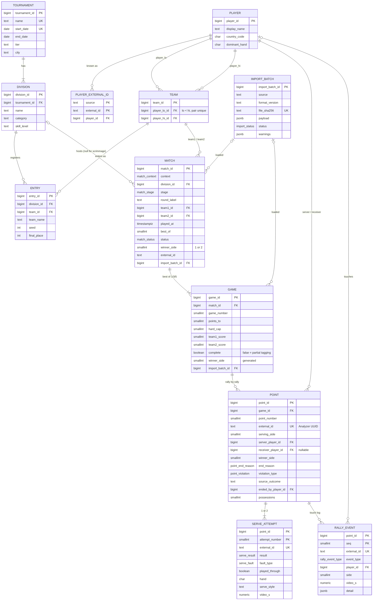

# Roundnet Analyzer database (PostgreSQL)

This folder holds a normalized PostgreSQL database for roundnet match data. It loads the JSON exports from Roundnet Analyzer and turns them into queryable tables of players, partnerships, tournaments, matches, games, points, serves and rally touches. The [queries](queries/) folder computes serve efficiency, kill % and hitting efficiency, partnership records, head-to-head records, rankings and rolling form in SQL.

The web app still runs entirely in the browser. This database sits beside it: export a match from the app, load the file here, and the stats can be compared across matches, players and partnerships, which the app's single-match view can't do.



## Quick start

With Docker:

```bash
docker compose -f db/docker-compose.yml up -d     # Postgres 16, schema preinstalled
export PGHOST=localhost PGUSER=roundnet PGPASSWORD=roundnet PGDATABASE=roundnet
db/scripts/load_examples.sh                        # loads the example matches
psql -f db/queries/serve_stats.sql
```

With an existing PostgreSQL 14+ server, set the usual `PG*` variables (or `DATABASE_URL`) and run `db/scripts/load_examples.sh`. To set up an empty schema without the examples, run `db/scripts/setup.sh`. Both are safe to re-run. `setup.sh --reset` drops the `roundnet` schema and everything in it first.

## Loading your own matches

Export a match from the app (Data Export → JSON), then run:

```bash
db/scripts/import.sh roundnet-match.json
# match 8

db/scripts/import.sh roundnet-match.json tournament.json   # optional match context
```

The optional second file adds context the export doesn't carry, such as the tournament, division, round and seeds. See [examples/match_info/](examples/match_info/) for samples and [import_format.md](import_format.md) for every field.

From SQL, call the loader directly: `SELECT roundnet.import_analyzer_export(export_jsonb, 'file name', match_info_jsonb);`

The loader reads every export version (v1 to v3). It is:

- **Idempotent.** Loading the same file twice does nothing. A newer export of the same match replaces the earlier load, matched by the Analyzer's point ids.
- **All or nothing.** A file that breaks a rule (a server who isn't in the match, an ace won by the receiver, an unsupported version) writes nothing except an `import_batch` row with the reason.
- **Forgiving of tagging slips.** Problems like out-of-order timestamps or a kill credited to the losing team still load, and are listed in `import_batch.warnings`.
- **Aware of partial tagging.** A game whose tagged points don't make a finished score is stored as partial. It counts toward serve, point and rally stats but not toward win rates.

## Example queries

| File | What it answers |
|---|---|
| [serve_stats.sql](queries/serve_stats.sql) | First- and second-serve in %, aces, double faults and hold % per server, plus each server's fault types |
| [hitting_stats.sql](queries/hitting_stats.sql) | Kill %, hitting efficiency, defensive touches kept up, sets and weak-set % per player (the same formulas as the app) |
| [partner_combos.sql](queries/partner_combos.sql) | Record, point win %, hold % and break % per partnership, and each player's best partner |
| [head_to_head.sql](queries/head_to_head.sql) | Player-vs-player records and team-vs-team results with game scores |
| [player_form.sql](queries/player_form.sql) | A leaderboard, and each player's rolling 3-match win rate, point differential and running record |

Sample output from `partner_combos.sql` on the example data:

```
  partnership   | matches | wins | match_win_pct | games | points  | point_win_pct | hold_pct | break_pct
----------------+---------+------+---------------+-------+---------+---------------+----------+-----------
 Alex / Blake   |       2 |    2 |         100.0 | 4-1   | 103-80  |          56.3 |     55.4 |      57.3
 Alex / Casey   |       1 |    1 |         100.0 | 1-0   | 21-17   |          55.3 |     57.1 |      52.9
 ...
```

## Schema design

- **A team is a partnership.** `team` stores each unordered pair of players once, as (lower id, higher id) with a unique constraint. Per-event details such as team name, seed and final placement live on `entry`. This makes partner-combination stats a simple GROUP BY.
- **Sides are numbered 1 and 2.** `match.team1_id`/`team2_id` hold the teams. Every result column (`winner_side`, `game.team1_score`, `point.serving_side`, `point.winner_side`) refers to a side, so a result can't name a team that wasn't in the match.
- **Game scores are stored and running scores are derived.** Public results only publish game scores, so `game` keeps them. Running scores within a game come from a window function in `v_point_detail`, so they can't drift from the point rows.
- **The rules of the sport are constraints.** Triggers check that the server is on the serving side, the receiver is on the other side, and the two teams in a match don't share a player. CHECK constraints keep aces won by the server, double faults lost by them, and violation types only on violation points. A composite foreign key requires both teams in a tournament match to be entered in its division.
- **Imports are reproducible.** Each file is stored verbatim in `import_batch.payload` with its SHA-256 hash, and points, serves and touches keep the Analyzer's UUIDs.
- **Analytics start from views.** `v_match_result` has one row per match, `v_player_match` one row per player per match (with partner, opponents and result), and `v_point_detail` one row per point with the running score.

## Files

| Path | What it is |
|---|---|
| [ddl.sql](ddl.sql) | Schema `roundnet`: types, tables, constraints, triggers and views |
| [import_analyzer.sql](import_analyzer.sql) | The loader, `import_analyzer_export()`, and its helper functions |
| [migrate_v3.sql](migrate_v3.sql) | Upgrades a database built from the pre-v3 schema. Fresh databases don't need it |
| [import_format.md](import_format.md) | How every export field maps to the tables, and the loader's checks |
| [erd.mmd](erd.mmd) / [erd.png](erd.png) | The ERD as Mermaid source and as an image |
| [queries/](queries/) | Example analytics queries |
| [examples/](examples/) | Six synthetic v3 match exports and one real v1 export (names changed), plus match-info files |
| [scripts/](scripts/) | `setup.sh`, `import.sh` and `load_examples.sh` |
| [docker-compose.yml](docker-compose.yml) | Local PostgreSQL 16 with the schema preinstalled |

## Tests

The [Database workflow](../.github/workflows/db.yml) runs on every change under `db/`. It builds the schema on PostgreSQL 16, loads all the examples, checks that each one loaded and that re-importing one is a no-op, runs every query, and applies the migration.
